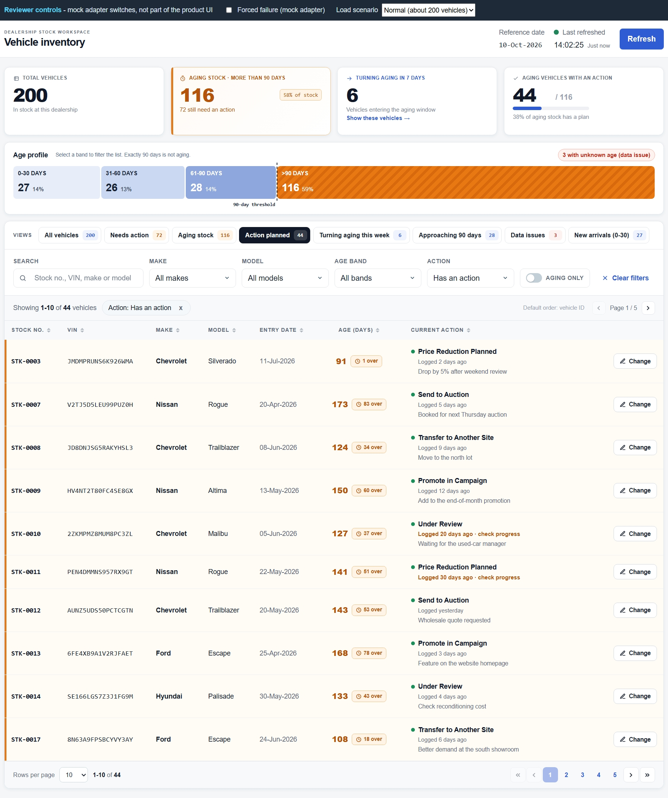

# Intelligent Inventory Dashboard

A React and TypeScript implementation of **Keyloop Scenario B: Intelligent Inventory Dashboard**. The application helps a dealership manager identify aging vehicles, filter the inventory, review data-quality issues, and record the current proposed action for eligible vehicles.

> **Assessment boundary:** the frontend is implemented. The backend is represented by a deterministic mock adapter behind an `InventoryService` interface. The mock and browser persistence are not presented as production services.

## Application preview



> Before submission, save the final dashboard screenshot at `docs/images/intelligent-inventory-dashboard.png`, or update the path above to the actual committed image.

## Scenario and implemented capabilities

The application implements a single-dealership inventory workspace with:

- Approximately 200 deterministic demonstration vehicles.
- Search by stock number, VIN, make, or model.
- Make, model, age-band, action, aging-only, and preset filters.
- Client-side pagination and three-state column sorting.
- Automatic aging classification using the rule **more than 90 complete calendar days**.
- Explicit 89, 90, and 91-day boundary records.
- Visibility of missing, invalid, and future stock-entry dates.
- A seven-day early-warning view for vehicles approaching aging.
- Summary indicators and an interactive age profile.
- A proposed-action workflow for aging vehicles only.
- Browser persistence of the current action, optional note, and logged time.
- Loading, empty-inventory, no-result, first-load failure, refresh-failure, and save-failure states.
- Reference date, last-refreshed time, elapsed freshness, and manual refresh.
- Assessment-level console logging with service-call correlation IDs.
- A React error boundary for unexpected rendering failures.

The implementation uses rule-based decision support. It does not use machine learning.

## Architecture

The application separates presentation, business rules, data access, and mock infrastructure:

```text
React UI and dashboard state
        |
        +--> Pure TypeScript core rules
        |
        +--> InventoryService interface
                  |
                  +--> Logging decorator
                             |
                             +--> MockInventoryService
                                      |
                                      +--> Deterministic generator
                                      +--> localStorage actions
```

The final design, diagrams, component responsibilities, data flows, technology choices, trade-offs, non-functional considerations, and future-production direction are documented in the [system design](docs/system-design.md).

A detailed architecture source is retained in [architecture documentation](docs/architecture/architecture.md).

## Technology choices

- **React:** component-based dashboard and user interactions.
- **TypeScript:** explicit domain types and service contracts.
- **Vite:** local development and production build tooling.
- **Vitest:** deterministic unit and service tests.
- **React Testing Library:** user-visible component and workflow tests.
- **Plain CSS and design tokens:** consistent styling without an additional UI framework.
- **localStorage:** assessment-only persistence of current vehicle actions.

## Prerequisites

- Node.js and npm
- A modern web browser
- Git, if cloning the repository

The repository does not require backend services, cloud credentials, or environment secrets.

## Installation and local run

```bash
git clone https://github.com/dunghuynh1990/intelligent-inventory-dashboard.git
cd intelligent-inventory-dashboard
npm install
npm run dev
```

Open the local URL printed by Vite.

## Verification commands

Run the complete automated test suite:

```bash
npm test
```

Run static analysis:

```bash
npm run lint
```

Create the production build:

```bash
npm run build
```

For final submission verification, run all three commands from a clean clone and confirm the application starts by following only this README.

## Reviewer scenarios

The mock adapter supports deterministic scenarios through URL query parameters:

| Scenario | Query parameter | Expected result |
|---|---|---|
| Forced service failure | `?forceFailure=true` | Shows the first-load service error, or a refresh/save failure where applicable. |
| Empty inventory | `?emptyInventory=true` | Shows the empty-inventory state. |
| Old data | `?dataAgeMinutes=25` | Shows a last-refreshed time 25 minutes old and the amber freshness state. |
| Stale data | `?dataAgeMinutes=60` | Shows the stale-data warning and refresh action. |
| Demo actions | `?demo=true` | Seeds sample actions for demonstration, subject to the current demo-mode behavior described below. |

Parameters can be combined, for example:

```text
?emptyInventory=true&dataAgeMinutes=25
```

### Current reviewer-tool behavior

The current application also mounts `src/dev/ReviewerBar.tsx` and enables demo mode from the entry point. Demo mode seeds sample actions for aging vehicles that do not already have an action, while preserving existing saved actions. This is assessment tooling, not product UI.

Before recording or demonstrating a clean action workflow, clear the application’s saved action storage and reload the desired scenario. The known demo-seeding limitation is listed below.

## Assumptions and interpretations

### Aging rule

- Aging means **more than 90 complete calendar days**.
- Exactly 90 days is not aging.
- Days are calculated from the stock-entry date against a reference date.
- The application uses the browser’s local calendar date and ignores time of day.
- The reference date is today at runtime and fixed and injected in tests.

### Age filters and early warning

- Age bands are `0-30`, `31-60`, `61-90`, and `>90` days.
- The early-warning window is days 84 to 90, meaning seven or fewer days before aging.
- Early warning is informational. Actions remain available only after a vehicle becomes aging.

### Search and filter behavior

- Search matches stock number, VIN, make, and model, case-insensitively.
- Filters combine using AND.
- Model options narrow to the selected make.
- Quick views, preset views, the Data issues control, and age-profile selections replace the current filter set instead of adding to it.
- Some filter combinations can return no results. The application shows a dedicated no-result state with Clear filters.

### Action model

- “Log an action” means save one current proposed action for an aging vehicle.
- A new action replaces the previous current action.
- The action is required; the note is optional.
- The five values are assessment placeholders: Price Reduction Planned, Transfer to Another Site, Send to Auction, Promote in Campaign, and Under Review.
- Full history, ownership, approval, and audit workflow are future scope.

### Data quality

- A missing, invalid, or future entry date produces an unknown age.
- A vehicle with an unknown age is not counted as aging and is not eligible for an action.
- The mock includes one example of each issue deliberately so the behavior can be reviewed.

### Persistence

Only the current action, optional note, and logged time are stored in the browser, keyed by vehicle ID. Filters, page, page size, sort, display density, and saved views are not intended as persisted product state.

Browser persistence demonstrates reload behavior for the assessment. It is single-browser, single-user, and not secure or durable production storage.

### “Real-time” interpretation

The dashboard shows the reference date, last-refreshed time, elapsed data age, and a manual Refresh action. It does not use polling or push updates.

The current freshness thresholds are placeholders:

- Normal: under 15 minutes
- Amber: 15 to 59 minutes
- Warning: 60 minutes or more

A production freshness target and the choice between polling and server push require business and operational validation.

## Testing approach

Business rules are kept in pure TypeScript functions and tested separately from React components. Tests cover:

- 89, 90, and 91-day aging boundaries.
- Calendar-day calculation with an injected reference date.
- Missing, invalid, and future entry dates.
- Age-band boundaries.
- Search, filters, action filters, presets, and sorting.
- Pagination slicing, page reset, and clamping.
- Freshness states and early-warning boundaries.
- Action validation, save, replacement, failure handling, and persistence.
- Service logging and correlation IDs.
- React error-boundary behavior.
- Loading, empty, no-result, stale-data, and failure states.

The test strategy favors observable behavior and accessible queries rather than snapshots or assertions against internal React state.

## AI collaboration narrative

GitHub Copilot in Visual Studio Code was used as a bounded implementation collaborator. Work was divided into WBS tasks and invoked using:

```text
/execute-wbs <WBS ID>
```

For each task, Copilot was instructed to:

1. Read the authoritative requirements, system design, decisions, WBS, traceability, and existing implementation.
2. Generate or update `docs/active-task.md` for the selected WBS ID.
3. Implement only the selected task and linked acceptance criteria.
4. Add or update focused tests.
5. Run the relevant tests, complete test suite, lint, and production build when code or configuration changed.
6. Inspect the final diff for unrelated changes, weakened tests, debug output, secrets, and scope drift.
7. Draft a factual entry in `docs/ai/collaboration-log.md`.
8. Stop before staging, committing, or pushing.

### Human review, verification, and correction

AI output was not treated as authoritative. Final decisions were checked against the assignment brief and approved repository baseline. Changes were accepted only after code review and verification.

Recorded examples include:

- **Aging-boundary verification:** the threshold comparison was deliberately changed so day 90 became aging. The exactly-90-days test failed as expected, after which the correct rule was restored and the suite passed.
- **CR rule verification:** targeted mutations were applied to VIN search, action filtering, pagination, entry-date issues, freshness, and summary behavior. The relevant tests detected the changes, and the correct implementation was restored.
- **Component-test correction:** adding an Action filter created a second control with the same accessible label as the action form. The tests were corrected by scoping queries to the intended form rather than weakening the assertions.
- **UI evolution correction:** after the age profile changed from a static graphic to accessible range buttons, the obsolete test query was replaced with assertions against the new accessible region and controls.

### AI limitations and ownership

AI suggestions can introduce unsupported requirements, excessive scope, incorrect assumptions, fragile queries, or code that passes superficial tests. Repository instructions therefore restrict Copilot to one active WBS task and prohibit silent decisions on open, proposed, deferred, rejected, future, or dropped items.

The repository owner remains responsible for requirements, architecture, scope decisions, code understanding, final verification, acceptance, commits, pushes, and the submitted work.

The supporting evidence is maintained in:

- [AI working procedure](docs/ai/working-procedure.md)
- [AI collaboration log](docs/ai/collaboration-log.md)
- [WBS catalogue](docs/wbs.md)
- [Requirements traceability](docs/traceability.md)
- [GitHub Copilot instructions](.github/copilot-instructions.md)

## Repository structure

```text
.github/
├── copilot-instructions.md        # Repository-wide Copilot governance
├── instructions/                  # Path-specific documentation, React, TS, and test rules
├── prompts/                       # Repository prompt definitions, if retained
└── skills/                        # execute-wbs, verify-task, and AI-log workflows

docs/
├── ai/                            # AI procedure and factual collaboration evidence
├── architecture/                  # Detailed implemented/future architecture source
├── decisions/                     # Decision register
├── images/                        # Submission screenshots
├── templates/                     # Reference templates only
├── wireframes/                    # Low-fidelity design artifacts
├── active-task.md                 # Current generated WBS execution snapshot
├── project-context.md             # Authority and conflict rules
├── requirements-baseline.md       # Acceptance criteria, assumptions, exclusions, DoD
├── system-design.md               # Canonical reviewer-facing system design
├── traceability.md                # WBS-to-requirement verification mapping
└── wbs.md                         # Repository WBS catalogue

src/
├── components/                    # Dashboard presentation components and styles
├── core/                          # Pure business rules and unit tests
├── observability/                 # Logger abstraction
├── services/                      # Service contract, logging decorator, mock adapter, data generator
├── test/                          # Vitest setup
├── types/                         # Vehicle and action domain types
├── App.tsx                        # Dashboard state and orchestration
└── main.tsx                       # Application composition and service wiring
```

## Known limitations

- The backend and persistence are mocked.
- `localStorage` is single-user, browser-specific, and not a secure production store.
- Authentication, authorization, multi-dealership tenancy, and concurrency controls are not implemented.
- The service returns a demonstration dataset; no production performance or capacity claim is made.
- Filtering, sorting, and pagination run in the browser.
- The assessment stores one current action rather than an audit history.
- Action values and freshness/stale-action thresholds require business validation.
- Production timezone and day-cutoff rules require confirmation.
- Observability uses browser logging only; there is no centralized telemetry, metric, trace, dashboard, or alerting platform.
- The application includes baseline accessibility semantics but has not undergone a formal accessibility audit.
- The reviewer bar and current demo-mode wiring are assessment tooling, not product behavior.
- The current demo seeding can accumulate actions across reloads until the seed-once behavior is corrected. Clear saved actions before a clean demonstration.

## Prioritized future improvements

### Priority 1: Production data and security

- Replace the mock with an authenticated HTTP adapter and Inventory API.
- Add durable vehicle, action, and audit-history storage.
- Add identity and dealership-based authorization.
- Add server-side validation and resilient persistence handling.

### Priority 2: Scale and operations

- Move filtering, sorting, and pagination to the server.
- Add centralized logs, metrics, traces, dashboards, and alerts.
- Confirm the freshness target and implement polling or server push.
- Add optimistic concurrency for multi-user updates.

### Priority 3: Workflow

- Add action ownership, due dates, history, and approval states.
- Confirm whether actions should be available before day 91.
- Add bulk actions with replacement confirmation and partial-failure handling.
- Add supported undo or action-revert behavior.

### Priority 4: User experience

- Add saved views and per-user display preferences.
- Add CSV export and print support.
- Complete broader responsive and accessibility validation.

## Submission references

- [System design](docs/system-design.md)
- [Detailed architecture](docs/architecture/architecture.md)
- [Requirements baseline](docs/requirements-baseline.md)
- [Traceability](docs/traceability.md)
- [AI collaboration log](docs/ai/collaboration-log.md)

## License

This repository is an assessment submission. No separate open-source license is declared unless a `LICENSE` file is added.
