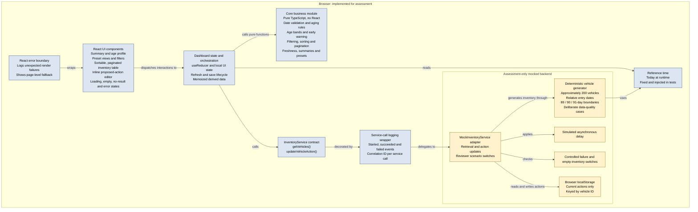
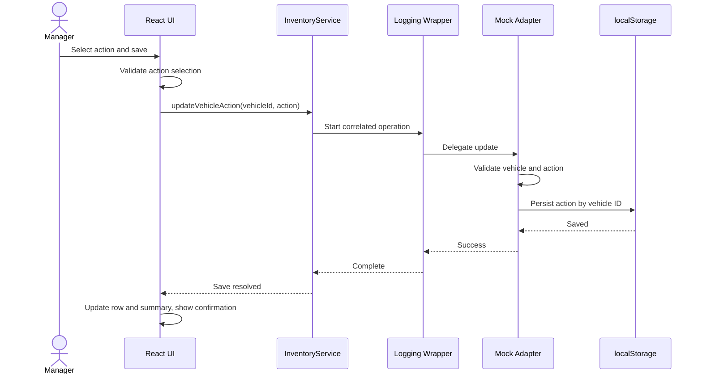
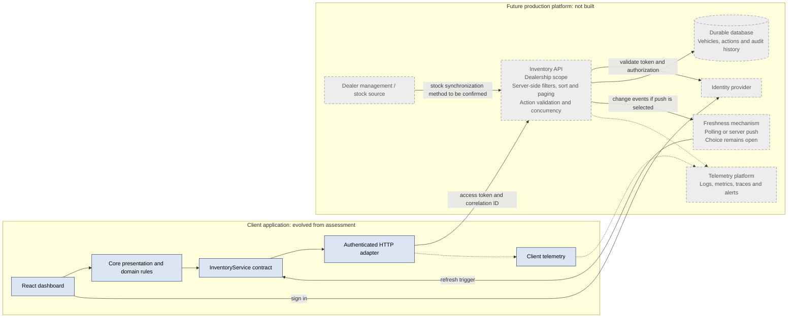

# Intelligent Inventory Dashboard: System Design

## 1. Purpose and Scope

This document describes the architecture of the **Scenario B: Intelligent Inventory Dashboard** assessment solution. The submitted implementation is a React and TypeScript frontend with a mocked backend behind an `InventoryService` boundary.

The implemented user journey covers:

- Displaying and filtering dealership inventory.
- Identifying vehicles held for more than 90 complete calendar days.
- Highlighting vehicles approaching the aging threshold.
- Logging and persisting a current proposed action for an aging vehicle.
- Showing data freshness, loading, empty, no-result and failure states.
- Demonstrating testable business rules through a framework-independent core module.

The assessment implementation is intentionally separated from the proposed future production architecture. Authentication, a real backend, a durable database, multi-dealership support and centralized telemetry are not implemented.

## 2. Key Requirements

The solution addresses the following core requirements:

1. **Inventory visualization:** Show a filterable vehicle list with search, make, model and age criteria.
2. **Aging-stock identification:** Treat a vehicle as aging only when it has been in inventory for more than 90 complete calendar days.
3. **Actionable insight:** Allow a manager to record and persist the current proposed action for an aging vehicle.

The delivered frontend also includes client-side pagination, sortable columns, summary indicators, an age profile, preset views, freshness indicators, controlled failure scenarios and baseline accessibility semantics.

## 3. Assumptions and Exclusions

### 3.1 Assumptions

- Aging means **more than 90 complete calendar days**. A vehicle at exactly 90 days is not aging.
- The reference date is today at runtime and a fixed injected date in automated tests.
- Age bands are `0-30`, `31-60`, `61-90` and `>90` days.
- The early-warning window is seven days before aging, covering days 84 to 90.
- Proposed actions are available only for aging vehicles.
- The application represents one dealership.
- The generated inventory of approximately 200 vehicles is demonstration scale, not evidence of production capacity.
- "Real-time overview" is interpreted as visible data freshness plus manual refresh. Live polling or push updates are future options.
- Browser `localStorage` is used only to demonstrate persistence across reloads.
- Freshness and stale-action thresholds are placeholders that require business validation.
- Entry dates are treated as dealership business dates. Production timezone and cut-off rules require confirmation.

### 3.2 Exclusions

The assessment does not implement:

- A production backend or durable database.
- Authentication, authorization or dealership tenancy.
- Multi-user concurrency or conflict handling.
- Complete action history, ownership, approval or audit workflows.
- Bulk actions, undo, saved views, CSV export or print layout.
- Formal load testing or formal accessibility certification.
- Centralized telemetry, alerting or distributed tracing.
- Polling, WebSocket or server-push updates.

## 4. Assessment Architecture

The following diagram represents the implemented assessment solution. Blue elements are implemented application components. Yellow elements are assessment-only mocks or browser persistence.

### 4.1 Assessment boundary

The following are implemented:

- React and TypeScript frontend.
- Dashboard state and orchestration.
- Pure TypeScript business rules.
- `InventoryService` abstraction.
- Mock inventory adapter and deterministic generated data.
- Browser-local action persistence.
- Simulated delay and reviewer-controlled scenarios.
- Service-call logging with correlation IDs.
- React error boundary.
- Unit, service and component/workflow tests.

The mock adapter and `localStorage` are assessment mechanisms. They are not presented as production-ready data services.

## 5. Component Responsibilities

### 5.1 React UI components

Present the operational dashboard and user workflows. Components render summary indicators, age profile, preset views, search and filters, the sortable inventory table, pagination and the inline proposed-action editor. Components use semantic labels and state attributes such as `aria-sort`, `aria-pressed`, live status messages and visible focus styles.

### 5.2 Dashboard state and orchestration

`App.tsx` owns inventory, filters, sorting, pagination, refresh state and action-editing state. A reducer applies state transitions. Memoized calculations derive available filter values, filtered and sorted vehicles, the current page, summaries, age profile and presets.

### 5.3 Core business module

`core/aging.ts` contains framework-independent functions for:

- Entry-date validation and classification.
- Days-in-stock and aging calculation.
- Age-band and early-warning classification.
- Inventory filtering and available filter values.
- Deterministic sorting and pagination.
- Inventory summary and age-profile calculations.
- Preset matching and counts.
- Freshness and action-age presentation rules.

Keeping this logic outside React allows direct unit testing without rendering components.

### 5.4 InventoryService contract

The frontend depends on two operations:

- `getVehicles()` retrieves the current inventory.
- `updateVehicleAction(vehicleId, action)` persists the current action for a vehicle.

The contract isolates the UI from the transport and persistence mechanism. A future HTTP adapter can replace the mock without rewriting presentation components.

### 5.5 Logging wrapper

The wrapper decorates service calls with started, succeeded and failed events and creates a correlation ID for each operation. Failed action saves expose the same reference to the user for troubleshooting. Browser console logging is the current sink.

### 5.6 Mock inventory adapter

The adapter simulates inventory retrieval and action updates. It provides deterministic data, asynchronous delay, controlled failure and empty-inventory scenarios, optional demo data and browser-based persistence.

### 5.7 Deterministic vehicle generator

The generator provides approximately 200 repeatable vehicles with reference-date-relative entry dates. It includes explicit 89, 90 and 91-day records and deliberate missing, invalid and future entry-date cases.

### 5.8 Browser storage

`localStorage` persists the current proposed action by vehicle ID so the action survives a reload. This mechanism is browser-specific, single-user and unsuitable for confidential production data.

### 5.9 Error boundary

The error boundary catches unexpected React render errors, records a diagnostic event and presents a recoverable page-level fallback.

## 6. Data Flow

### 6.1 Initial inventory load and manual refresh

1. The dashboard calls `InventoryService.getVehicles()`.
2. The logging wrapper creates a correlation ID and records the call start.
3. The mock adapter applies the simulated delay and checks reviewer scenario switches.
4. The generator creates deterministic vehicle records relative to the reference date.
5. The adapter reads persisted actions from browser storage and merges them into the vehicle list.
6. The logging wrapper records success or failure.
7. On success, the application stores the inventory and refresh timestamp.
8. Pure core functions derive summaries, age profile, presets, filter values, sorted rows and the current page.
9. React renders the dashboard.
10. If a later refresh fails, the last successful inventory remains visible and the dashboard offers Retry.

### 6.2 Filtering, sorting and pagination

1. The user changes search, make, model, age band, action or aging-only criteria, or chooses a preset.
2. The reducer updates the filter state and returns to page one.
3. Pure functions filter and sort the in-memory inventory.
4. Pagination clamps the page and slices the result set.
5. React updates the result count, chips, table and pager without a service call.

This client-side flow is appropriate for the assessment dataset. Production scale would move filtering, sorting and paging to the API.

### 6.3 Proposed-action save

1. The manager opens the inline editor for an aging vehicle.
2. The form validates that an action is selected.
3. The dashboard calls `updateVehicleAction(vehicleId, action)`.
4. The logging wrapper assigns a correlation ID and records the operation.
5. The mock adapter validates the target vehicle and action.
6. The adapter stores the action in `localStorage` with a logged timestamp.
7. On success, the dashboard updates the row and summary, closes the editor and shows confirmation.
8. On failure, the existing row remains unchanged, the editor stays open and the error displays a correlation reference when available.

### 6.4 Action-save sequence

## 7. Technology Choices

| Technology | Purpose | Justification |
|---|---|---|
| React | Component-based frontend | Supports an interactive single-page dashboard with focused, reusable UI components. |
| TypeScript | Domain types and contracts | Makes vehicle, filter and service boundaries explicit and reduces integration mistakes. |
| Vite | Development and production build | Provides a lightweight toolchain and fast feedback loop for a focused frontend assessment. |
| Vitest | Unit and integration testing | Fits the Vite toolchain and supports deterministic tests for pure business rules and services. |
| React Testing Library | Component and workflow testing | Validates user-visible behaviour rather than testing component internals. |
| Plain CSS with design tokens | Styling and visual consistency | Keeps dependencies limited while providing consistent colours, spacing, focus states and layout. |
| Browser localStorage | Assessment persistence | Demonstrates persistence across reloads without implementing a backend. Its production limitations are explicitly documented. |
| Mermaid and Draw.io | Architecture communication | Mermaid keeps flows reviewable in source control, while Draw.io provides polished implemented and future-state diagrams. |

## 8. Key Design Decisions and Trade-offs

### 8.1 Frontend implementation with mocked backend

The assessment permits one service layer to be implemented fully. The frontend was selected to demonstrate the complete manager workflow. A replaceable service contract prevents the UI from depending directly on mock data or browser storage.

**Trade-off:** production persistence, authorization, concurrency and API validation remain outside the implementation.

### 8.2 Pure business logic outside React

Aging, filtering, sorting, pagination and freshness rules are implemented as deterministic TypeScript functions.

**Trade-off:** the application has additional module boundaries, but gains simpler testing and clearer ownership of business rules.

### 8.3 Local React state instead of a global state library

The application has one dashboard and a bounded state surface, so `useReducer`, local state and memoized derivations are sufficient.

**Trade-off:** a larger multi-page product could require dedicated server-state or global-state tooling.

### 8.4 Current action instead of action history

The prototype persists one current proposed action with an optional note and logged time.

**Trade-off:** production requirements may need action ownership, due dates, approvals, history and auditability.

### 8.5 Client-side filtering, sorting and pagination

The approximately 200-record demonstration dataset is processed in the browser.

**Trade-off:** this is simple and responsive at assessment scale, but it is not a production-scale performance claim. Future filtering, sorting and paging should be server-side.

### 8.6 Manual refresh instead of live updates

The dashboard shows last-refreshed time, elapsed freshness and a manual refresh action.

**Trade-off:** the implementation is not true real-time. Polling or push should be selected only after confirming the business freshness target.

### 8.7 Structured actions plus optional note

A controlled action list supports consistent filtering and reporting while the note allows context.

**Trade-off:** the action vocabulary is a placeholder and requires dealership validation.

## 9. Non-Functional Considerations

### 9.1 Scalability

The assessment processes approximately 200 vehicles in the browser to demonstrate behaviour. The proposed production architecture moves dealership scoping, filtering, sorting and pagination to an Inventory API backed by a durable database. API scaling, data partitioning and database indexing would be designed after production volume and usage patterns are known.

### 9.2 Performance

Memoized derived calculations and client-side pagination limit unnecessary work for the demonstration dataset. No formal load test or production-capacity claim is made. Future options include server-side queries, caching and row virtualization where measured usage justifies them.

### 9.3 Reliability

The implementation includes deterministic business rules, explicit loading and failure states, retry actions, preservation of the last successful inventory after refresh failure, a React error boundary and automated tests for domain boundaries and failure paths. The mock storage layer remains a limitation and does not provide production durability or concurrency guarantees.

### 9.4 Maintainability

Maintainability is supported by:

- Framework-independent business logic.
- A replaceable service contract.
- Focused React components.
- TypeScript domain models.
- Named constants for thresholds.
- Deterministic generated data and tests.
- Separation between assessment implementation and future production design.

### 9.5 Security and privacy

Authentication and authorization are not implemented. Browser storage is not suitable for confidential production information. The future design introduces an identity provider, authenticated API calls, server-side dealership authorization and durable audit records. Production telemetry should avoid action-note content and other unnecessary business data. Secrets and credentials must not be committed to the frontend repository.

### 9.6 Observability

Implemented observability consists of:

- A logger abstraction.
- Service-call started, succeeded and failed events.
- One correlation ID per service operation.
- Correlation reference on failed saves.
- A React error boundary for unexpected render failures.

Current logs remain in the browser console. Centralized log collection, metrics, traces, dashboards and alerting are future production capabilities. The implementation therefore demonstrates observability hooks without claiming production monitoring.

## 10. Future Production Architecture

The future architecture preserves the frontend service boundary and replaces assessment-only components with authenticated production services.

### 10.1 Production evolution

The production design would:

- Replace `MockInventoryService` with an authenticated HTTP implementation.
- Introduce identity, dealership authorization and server-side validation.
- Persist vehicles, actions and audit history in a durable database.
- Integrate with an authoritative vehicle-stock source.
- Move filtering, sorting and paging to the server.
- Add centralized logs, metrics, traces, dashboards and alerts.
- Add concurrency controls for multiple managers.
- Select polling or push only after confirming the freshness target.

All components in this section are proposed and not implemented.

## 11. Prioritized Future Improvements

### Priority 1: Production data and security foundations

1. Implement an authenticated HTTP adapter and Inventory API.
2. Add durable storage for vehicles, actions and audit history.
3. Add identity, dealership-based authorization and server-side validation.
4. Add resilient handling and migration for persisted data.

### Priority 2: Scale and operational reliability

5. Move filtering, sorting and pagination server-side.
6. Add centralized telemetry, metrics, traces and alerting.
7. Confirm the freshness target and implement polling or push updates.
8. Add optimistic concurrency for multiple managers updating a vehicle.

### Priority 3: Workflow capability

9. Add action ownership, due dates, history and approval states.
10. Validate whether vehicles approaching aging should accept actions.
11. Add bulk action processing with partial-failure handling.
12. Add undo or explicit action replacement history.

### Priority 4: User experience

13. Add saved views and remembered display preferences.
14. Add CSV export and print support.
15. Complete broader responsive and accessibility validation.

## 12. GenAI Use in the Design Phase

GenAI was used as a bounded design and implementation collaborator. The scenario scope, acceptance criteria, assumptions and architectural boundaries were defined before requesting implementation help. Work was decomposed into small tasks so generated changes could be reviewed and tested independently.

AI-assisted outputs were checked against the assessment brief, the requirements baseline and the delivered application. Verification included code review, automated tests, manual execution, comparison of UI behaviour with acceptance criteria and correction of inconsistencies. Suggestions were accepted, changed or rejected according to requirement alignment, delivery risk and implementation evidence.

Real examples from the AI decision and verification log should be summarized here before submission. Suitable examples are only those actually recorded in the log, such as:

- A generated or suggested design decision that was corrected after comparison with the requirements.
- A defect found through code review or deliberate test failure.
- A suggestion that was rejected because it added unnecessary scope or weakened reliability.

GenAI accelerated design exploration, boilerplate, test ideas and review. Final architecture decisions, validation and acceptance remain human-owned.

## 13. Known Limitations

- The backend and persistence are mocked.
- Browser storage is single-user and not secure or durable.
- Data generation is deterministic but is not a production data model or load test.
- No authentication, authorization, multi-dealership tenancy or concurrency control is implemented.
- One current action is stored. Full workflow and history are not implemented.
- Freshness, early-warning and stale-action thresholds require business validation.
- The implementation has baseline accessibility semantics but no formal audit.
- Centralized telemetry, metrics, traces and alerts are not implemented.
- Production timezone and date-cut-off rules require confirmation.

## 14. Diagram Legend

- **Blue boxes:** Implemented application components.
- **Yellow boxes:** Assessment-only mocks or browser persistence.
- **Grey dashed boxes:** Future production components that are not built.
- **Solid arrows:** Functional data or control flow.
- **Dotted arrows:** Telemetry flow.
