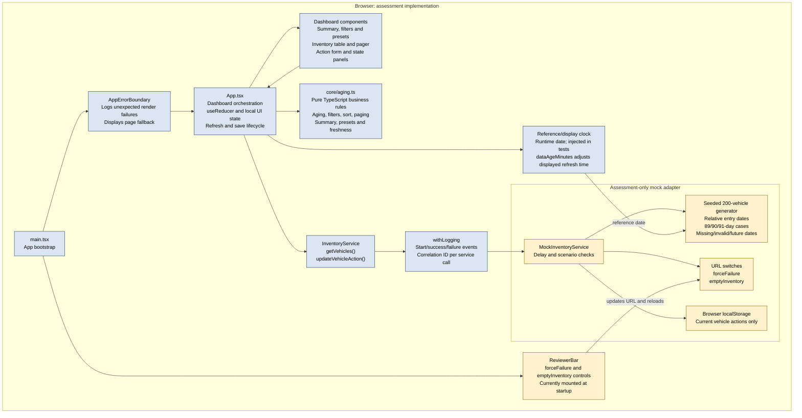
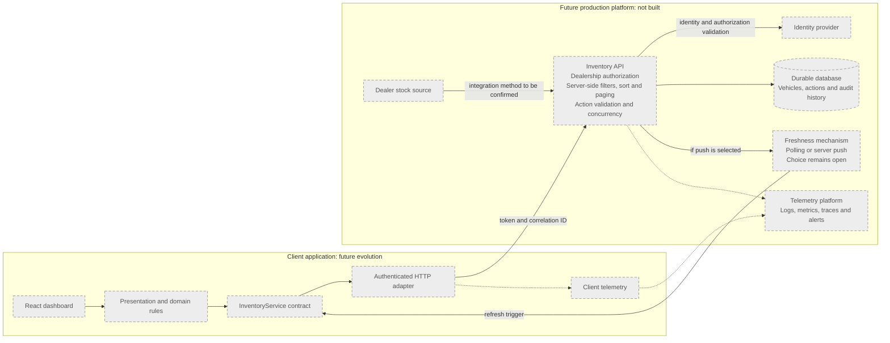

# Intelligent Inventory Dashboard: Unified System Design

## 1. Purpose and authority

This document is the consolidated reference for the implemented Scenario B assessment and its explicitly separate future-production direction. It replaces the initial design snapshot and incorporates the architecture description formerly maintained in `docs/architecture/architecture.md`.

The assignment brief, `docs/requirements-baseline.md`, approved assumptions, applied decisions and active WBS task remain authoritative in their stated order. This document describes the design; it does not create or approve requirements, assumptions, or proposed decisions. Where implementation and a decision-register status differ, both are identified rather than silently reconciled.

## 2. Scope and status

### Implemented assessment

- React, TypeScript and Vite frontend for a single-dealership demonstration.
- Mocked inventory backend behind the typed `InventoryService` boundary.
- Deterministic generator for approximately 200 vehicles.
- Pure TypeScript date, aging, filtering, sorting, pagination, summary and freshness rules.
- Browser-local persistence for the current proposed action only.
- Manual refresh, visible last-refreshed time, elapsed time and freshness levels.
- Assessment-level console logging, service-call correlation IDs and React error boundary.
- URL-controlled mock scenarios and a reviewer-control component mounted at the app entry point.

### Not implemented as production services

There is no production backend, database, authentication, authorization, dealership tenancy, multi-user concurrency, centralized telemetry, polling or server-push update path. Those capabilities are future architecture only.

The mock inventory, local storage and reviewer controls are assessment/dev mechanisms, not production service implementations. In the currently delivered app, `main.tsx` mounts the reviewer bar unconditionally; it is outside the dashboard component tree but visible while the app runs. This observed behavior is not a decision that the bar belongs in product UI.

## 3. Assessment architecture

Blue boxes are implemented app components and boundaries; yellow boxes are assessment-only mock or browser mechanisms. The reviewer bar is kept separate from the product dashboard but currently rendered by the app entry point.

## 4. Implemented component responsibilities

### Application bootstrap and dashboard

- `src/main.tsx` creates one `MockInventoryService`, wraps it with `withLogging`, and renders the reviewer controls and `App` inside `AppErrorBoundary`.
- `src/App.tsx` owns dashboard state and orchestration: inventory, filters, sort, page, refresh lifecycle and action editing/saving. It memoizes derived results and delegates visible areas to focused components.
- `src/components/` contains the summary, filter controls/chips, preset controls, inventory table, pager, proposed-action form and inventory state panel.

### Pure domain and view logic

`src/core/aging.ts` is framework-independent. It implements calendar-date validation, age/aging classification, age bands, early warning, filtering, sorting, pagination, summaries, presets, freshness levels and action-age presentation.

### Service boundary and mock adapter

`src/services/inventory-service.ts` defines:

- `getVehicles(): Promise<Vehicle[]>`
- `updateVehicleAction(vehicleId, action): Promise<void>`

`MockInventoryService` implements that contract. It generates the vehicle set when the service instance is created, applies a simulated delay to operations, checks forced failure, optionally returns an empty list, and reads/writes saved actions. A future service adapter may replace this mock without making React components depend on storage or transport details.

### Logging and render-error boundary

`withLogging` wraps service operations with started, succeeded and failed console events and creates a correlation ID per call. Failed action saves are rethrown as correlated errors for the save UI; inventory-load failures are logged and shown with retry but do not expose a correlation reference. `AppErrorBoundary` logs unexpected render failures and displays a page-level fallback.

This is assessment-level observability, not centralized production monitoring. WBS 4.10 is currently recorded as Not Started, not Dropped, while the corresponding logging and error-boundary code is present. Do not describe observability as design-only or change the WBS status in this document.

## 5. Assessment behavior and data flow

### Initial load and refresh

1. `App` calls `InventoryService.getVehicles()` on mount and when the user requests Refresh.
2. `withLogging` records the service operation.
3. The mock waits for its configured delay and checks forced failure.
4. If `emptyInventory` is active, the service returns an empty array. Otherwise, it joins the generated vehicles with persisted current actions.
5. On success, `App` stores the returned inventory and refresh time; pure functions derive summary, presets, filters, sort order and page.
6. A failed initial load shows the full inventory error panel with Retry. A failed later refresh preserves the last successful inventory and refresh timestamp and displays an inline retry banner.
7. An empty service result displays the dedicated empty-inventory panel instead of the inventory summary, filters and table.

The generator runs when the mock service is constructed; it is not regenerated on each refresh.

### Filtering, sorting and paging

- Search covers stock number, VIN, make and model, case-insensitively. Make, model, age band, aging-only, data-issue, early-warning and action filters combine with AND.
- Model choices depend on the selected make. Quick presets replace the complete filter set.
- Without a selected sort, rows use vehicle-ID order. Optional column sorting changes the current view; sort state is not persisted.
- Client-side page sizes are 10, 20, 50 and 100, defaulting to 20. Filter changes reset to page 1; result reductions clamp the current page.
- Summary values are calculated over the complete loaded inventory; the table and pager use filtered results.

### Proposed-action save

1. An aging vehicle may open the action form. An action is required; the note is optional.
2. The save calls `updateVehicleAction` through the service boundary. The UI updates only after the service succeeds.
3. The mock stores the current action, optional note and logged timestamp in local storage, keyed by vehicle ID. A new save replaces that vehicle's previous action.
4. On failure, the previous successful row state is retained and the form remains available for retry.

Only saved actions are persisted. Filters, sort, page and page size are not persisted.

## 6. Assumptions and exclusions

The following WBS 1.3 assumptions are carried into this design:

- Aging means more than 90 complete calendar days; exactly 90 days is not aging.
- The reference date is today at runtime and fixed in tests.
- Mock entry dates are generated as offsets from the reference date.
- Age bands are 0-30, 31-60, 61-90 and greater than 90 days.
- Proposed actions are available only for aging vehicles.
- “Real-time” means a visible last-refreshed time and manual refresh.
- The assessment supports one dealership.
- Local persistence is for demonstration only.

Additional fixed business rules include use of the browser's local calendar date with time of day ignored; invalid or future entry dates have unknown age and are not aging; filters combine with AND; and a current action replaces the previous action.

Excluded from the assessment are a production backend/database, authentication/authorization, multi-dealership support, production deployment/CI/CD, action history/approval, bulk actions, undo, CSV/print, saved views, density preference persistence, a dedicated tablet/mobile layout, a production telemetry platform, and polling/WebSocket/server-push updates. Basic responsive CSS and horizontal table scrolling are present.

## 7. CR decision status and implementation reconciliation

Decision status below is copied from `docs/decisions/decision-register.md` as currently recorded. An implemented behavior does not change a Proposed decision's status. This document does not select or apply D30-D40.

| Decision | Register status | Design/reference treatment |
|---|---|---|
| D30: CR tiering and disclosure | Proposed | Preserve Must scope; distinguish approved, proposed and future work. |
| D31: client-side pagination | Proposed | The code implements page sizes 10/20/50/100, default 20, reset/clamp behavior and no page persistence (C-20). Server-side paging remains future. |
| D32: optional column sorting | Proposed | The code includes session-only sorting; with no active sort, vehicle-ID order remains the default. |
| D33: early-warning cues | Proposed | The code uses one seven-day window, days 84-90; cues are informational and do not enable actions before aging (C-22). |
| D34: persistence scope | Proposed | Current actions and notes persist; view state does not (C-23). |
| D35: bulk actions and undo | Proposed | Not built; describe as Future (E-10/E-11). |
| D36: other mockup polish | Proposed | CSV/print, saved views, density toggle, mockup notes/overlay and artificial delay are not built; see E-12 to E-15. Basic responsive CSS and table scrolling exist, but a dedicated tablet/mobile layout is out of scope (E-14). |
| D37: freshness indicators | Proposed | Code uses named 15-minute amber and 60-minute warning placeholders; manual refresh remains the update mechanism (C-24). |
| D38: data-quality visibility | Selected | Missing, invalid and future entry dates are shown as data issues with unknown age and are not aging. |
| D39: reviewer switches and demo mode | Proposed | URL switches and sample seeding exist. The reviewer bar is currently mounted unconditionally, and `main.tsx` passes `demoMode: true`; these implementation facts differ from the proposed dev-only/not-product-UI treatment. |
| D40: design fidelity | Proposed | React structure is implemented separately from the static mockup; the dashboard uses project CSS tokens and a blue focus ring. |

### Reviewer controls and sample data: observed discrepancy

`src/dev/ReviewerBar.tsx` exposes `forceFailure` and `emptyInventory` by updating the URL and reloading. `dataAgeMinutes` is read at startup in `main.tsx` and adjusts the displayed last-refreshed clock. The bar is rendered in all current app runs, not conditionally hidden as a dev-only control. The product components do not own these switches.

The mock adapter has an optional `demoMode` option, but `main.tsx` explicitly sets it to `true`; therefore, the current app seeds demo actions at startup without requiring `?demo=true`. The current seed list has 22 samples and only fills aging vehicles that do not already have an action; empty-inventory mode skips seeding. This does not overwrite existing saved actions. These differences are documented, not changed, by this WBS task.

### Deferred CR items

The following items are Future, not part of the implemented assessment:

| ID | Future item |
|---|---|
| E-10 | Bulk select and bulk apply of actions |
| E-11 | Undo of a saved action |
| E-12 | CSV export and print layout |
| E-13 | Saved views, density toggle and remembered UI preferences |
| E-14 | Tablet and mobile layouts beyond the approved laptop scope |
| E-15 | Mockup-only notes cards, requirement-ID overlay and artificial filter delay |

## 8. Technology choices and trade-offs

| Choice | Rationale | Trade-off / boundary |
|---|---|---|
| React + TypeScript + Vite | Focused frontend with explicit domain/service types and a lightweight build workflow. | Does not supply backend services or production persistence. |
| Pure TypeScript business rules | Date, filter, sort, paging and freshness behavior can be tested without React. | Requires clear boundaries between view orchestration and domain calculations. |
| Local reducer and component state | Sufficient for one dashboard and its bounded state. | A larger multi-page system may need different state ownership. |
| Mock `InventoryService` adapter | Demonstrates the replaceable contract while keeping components away from generated data and storage. | Does not represent API validation, durability, authorization or concurrency. |
| Client-side processing of about 200 vehicles | Appropriate to the deterministic assessment dataset. | Not a production-scale performance claim; production may move queries server-side after needs are measured. |
| One current action, not history | Meets the assessment persistence workflow with a required action and optional note. | No ownership, approvals, audit trail, due date or action history. |
| Browser local storage | Demonstrates persistence across reloads. | Single-browser, single-user, non-confidential and non-durable. |
| Manual refresh and freshness display | Makes the reference time visible without implying live updates. | Freshness thresholds are placeholders; no polling or push mechanism exists. |
| Plain CSS and project tokens | Keeps dependencies limited and supports consistent styling. | Responsive scope is limited; the inventory table may scroll horizontally at narrower widths. |

## 9. Non-functional direction

- **Scalability:** The assessment processes about 200 vehicles in the browser. Production volume, server-side query design and database strategy require measured workload and confirmed requirements.
- **Performance:** Derived views are memoized, but no formal capacity or response-time claim is made.
- **Reliability:** Loading, empty, no-results and service-error states are explicit. Retry is provided; later refresh failure retains loaded data. The mock store provides no durability or concurrency guarantee.
- **Maintainability:** Pure rules, typed service contracts, focused components and tests keep responsibilities reviewable.
- **Security/privacy:** No credentials, real customer data, identity or authorization are implemented. Browser storage and client checks are not security boundaries.
- **Observability:** Browser console logs and a render-error boundary are assessment hooks only. Centralized logs, metrics, traces, dashboards and alerts are future capabilities.
- **Freshness:** The 15/60-minute levels are named placeholders, not an agreed business service target.

## 10. Future production architecture (not built)

This is a direction for future design, not a deployed or implemented system.

Potential future work includes authenticated API integration, durable storage, dealership authorization, stock-source integration, server-side querying, concurrency controls and centralized operational telemetry. The freshness mechanism remains an open design choice.

## 11. GenAI use and verification evidence

GenAI has been used as an implementation and documentation collaborator under repository-owner direction. The factual task records in [`docs/ai/collaboration-log.md`](./ai/collaboration-log.md) include examples:

- WBS 5.1 used a temporary aging-threshold mutation to confirm the existing day-90 test detects a defect; the implementation was restored.
- WBS 5.6 used 12 temporary mutations across filtering, paging, date classification, generated boundaries, freshness and summary behavior; all were detected and restored before verification.
- WBS 4.10 added assessment-level service logging and a React error boundary; the log records focused/full tests, lint, build and diff checks.
- WBS 4.13 and 4.14 records describe generated VIN/date cases and reviewer scenarios, plus their test and browser checks.

The collaboration log marks prior work as pending repository-owner review. This summary does not claim that the repository owner accepted every AI-produced change. Current requirements and applied decisions take precedence over generated suggestions. No unrecorded example, correction or test result is inferred here.

## 12. Known limitations and references

- Mock service and local storage are not production data infrastructure.
- No authentication, authorization, multi-dealership scope, user identity or concurrency control exists.
- Sample inventory is deterministic demonstration data, not a production data model or load test.
- Actions have no history or approval workflow.
- Freshness and early-warning thresholds need business validation.
- Reviewer bar visibility and unconditional demo seeding are current implementation facts that differ from the Proposed D39 treatment.
- The status of Proposed D30-D37 and D39-D40 has not been changed by this document.

Authoritative context and detailed requirements are maintained in [`docs/requirements-baseline.md`](./requirements-baseline.md), [`docs/decisions/decision-register.md`](./decisions/decision-register.md), [`docs/wbs.md`](./wbs.md) and [`docs/traceability.md`](./traceability.md).
